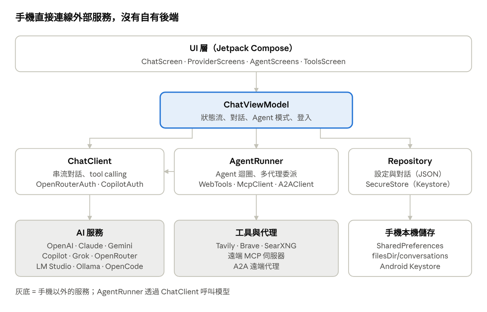

# AI Chat Hub 使用說明與技術手冊

Nov 5, 2026 · @民哥

## 1. 概覽

AI Chat Hub 是一個 Android App，用同一個介面和各家雲端 AI 平台與本地模型對話，並提供 Agent、上網搜尋、MCP、A2A 與多代理團隊功能。所有設定、對話與金鑰都只存在手機本機。

**版本狀態：** 1.0.0，原始碼已完成，但尚未編譯與實機測試（開發環境無法下載 Android SDK）。第一次建置可能出現編譯錯誤，需要依錯誤訊息修正。

| 類別                         | 內容                                                                                                                           |
|------------------------------|--------------------------------------------------------------------------------------------------------------------------------|
| 預設服務（首次啟動自動建立） | GPT（OpenAI）、Claude（Anthropic）、Gemini（Google）、GitHub Copilot、Grok（xAI）、OpenRouter、LM Studio（本地）               |
| 可另外新增的服務             | OpenCode Zen、OpenCode Zen（Claude 模型）、OpenCode Server、Ollama、Groq、DeepSeek、Mistral、Together AI、任何 OpenAI 相容端點 |
| 驗證方式                     | API Key、OpenRouter 帳號登入（OAuth PKCE）、GitHub 帳號登入（裝置碼）、OpenCode Server 密碼、本地免驗證                        |
| 對話功能                     | 串流輸出、停止、重新產生、系統提示詞、多對話管理、模型清單自動抓取                                                             |
| Agent 功能                   | 工具呼叫迴圈、上網搜尋、讀取網頁、目前時間、MCP 工具、A2A 遠端代理、多代理團隊（最多 3 層委派）                                |
| 系統需求                     | Android 8.0（API 26）以上，需要網路連線                                                                                        |

## 2. 安裝

專案附帶 GitHub Actions 工作流程（`.github/workflows/build.yml`），不需安裝 Android Studio 就能在雲端產生 APK。

### 2.1 雲端建置（建議）

1. 在 GitHub 建立一個新的 repository（可設為 Private）。
2. 解壓 `AIChatHub.zip`，把 `AIChatHub` 資料夾內的所有檔案推到 `main` 分支。
3. 推送後 Actions 會自動執行「Build APK」；也可以在 Actions 頁面按 Run workflow 手動執行。
4. 執行成功後，打開該次執行紀錄，在 Artifacts 下載 `AIChatHub-debug-apk`。
5. 解壓得到 `app-debug.apk`，傳到手機後點擊安裝。

若建置失敗，在該次執行的「Build debug APK」步驟複製錯誤訊息，依訊息修正原始碼後再推送。

### 2.2 安裝到手機

- 第一次安裝時，系統會要求允許「安裝未知應用程式」，請對使用的檔案管理員或瀏覽器開啟。
- debug 版以預設除錯金鑰簽署，可直接安裝，但不適合上架 Google Play。
- 更新時直接安裝新版 APK 即可，資料會保留；若簽章不同（例如換了建置環境），需要先解除安裝舊版。

### 2.3 本機建置

需要 JDK 17 以上與 Android SDK（Platform 35）。設定 `ANDROID_HOME` 或在專案根目錄建立 `local.properties`（`sdk.dir=...`），然後執行：

```bash
./gradlew assembleDebug
```

產出位置：`app/build/outputs/apk/debug/app-debug.apk`。也可以直接用 Android Studio 開啟專案資料夾執行。

## 3. 使用說明：服務設定與對話

第一次開啟 App 會自動建立 7 個預設服務，只要替其中一個填入金鑰或登入，就能開始對話。

### 3.1 主畫面

- **左上角選單**：開啟側邊欄，內含「新對話」、「AI 服務設定」、「Agents 與多代理團隊」、「工具：搜尋 / MCP / A2A」，以及歷史對話清單（可刪除）。
- **頂端標題**：顯示目前的 Agent、服務與模型，點一下開啟「選擇服務與模型」對話框。
- **鉢筆圖示**：設定這個對話的系統提示詞（System Prompt）。
- **＋ 圖示**：開新對話，沿用目前的服務、模型與 Agent。
- **輸入列**：送出訊息；回應進行中按 × 可以停止。最後一則回覆下方有「重新產生」。
- **長按訊息**：可以選取並複製文字。

### 3.2 各服務的設定方式

到「AI 服務設定」點選服務，填入下表的驗證資料後按「儲存」。儲存金鑰後 App 會自動抓取模型清單；也可以按「測試連線」手動抓取。

| 服務                | 驗證方式            | 取得方式與備註                                                                                                                    |
|---------------------|---------------------|-----------------------------------------------------------------------------------------------------------------------------------|
| GPT（OpenAI）       | API Key             | platform.openai.com/api-keys                                                                                                      |
| Claude（Anthropic） | API Key             | console.anthropic.com                                                                                                             |
| Gemini（Google）    | API Key             | aistudio.google.com/apikey，有免費額度                                                                                            |
| GitHub Copilot      | GitHub 帳號登入     | 按「使用 GitHub 帳號登入」→「複製並開啟 GitHub」→ 在 GitHub 頁面貼上驗證碼並授權 → 回到 App 自動完成。需 Copilot 訂閱（含免費版） |
| Grok（xAI）         | API Key             | console.x.ai                                                                                                                      |
| OpenRouter          | OpenRouter 帳號登入 | 按「使用 OpenRouter 帳號登入」，在瀏覽器授權後自動取得金鑰                                                                        |
| LM Studio（本地）   | 不需要              | 電腦上 LM Studio → Developer → Start Server，開啟 Serve on Local Network；Base URL 改成 `http://電腦IP:1234/v1`                   |
| Ollama（本地）      | 不需要              | 電腦執行 `OLLAMA_HOST=0.0.0.0 ollama serve`；Base URL `http://電腦IP:11434/v1`                                                    |
| OpenCode Zen        | API Key             | opencode.ai 申請；Claude 系列模型請用「OpenCode Zen（Claude 模型）」                                                              |
| OpenCode Server     | 伺服器密碼          | 見 3.4                                                                                                                            |

刪掉預設服務後，可以在「AI 服務設定」右上角按「補回預設」。按右下角＋可以從範本新增其他服務，或選「自訂（OpenAI 相容）」連接 vLLM、LiteLLM 等端點。

### 3.3 選擇模型與開始對話

1. 點頂端標題，在「模式」選「一般對話（串流）」。
2. 在「AI 服務與模型」選服務，再從清單點選模型（模型多時可用「篩選」搜尋），也可以直接輸入模型名稱。
3. 按「確定」，在下方輸入訊息送出。

同一個對話中可以隨時切換服務，先前的對話內容會一起送給新的模型。

### 3.4 OpenCode Server

在電腦或雲端主機上執行：

```bash
OPENCODE_SERVER_PASSWORD=你的密碼 opencode serve --hostname 0.0.0.0 --port 4096
```

- App 中 Base URL 填 `http://主機IP:4096`，密碼欄填上面的密碼（帳號預設 `opencode`，或填 `帳號:密碼`）。
- 模型格式為 `providerID/modelID`（例如 `anthropic/claude-sonnet-5-5`），留空則用 OpenCode 的預設模型。
- OpenCode 會在伺服器端保留對話與執行工具，回覆在 agent 完成後一次顯示（不串流）。
- 若要從外網連線，務必設密碼，並放在 HTTPS 反向代理或 Tailscale 後面。

## 4. 使用說明：Agent 與多代理團隊

Agent 模式下，模型會自行決定何時上網搜尋、讀網頁、呼叫 MCP 工具或委派團隊成員，每一步都會以小卡片顯示在對話中。

### 4.1 啟用 Agent 模式

1. 點頂端標題，在「模式」選一個 Agent（例如「上網助理」或「專案經理（多代理團隊）」）。
2. 在下方選擇服務與模型：設為「跟隨對話」的 Agent 會使用這裡選的模型。
3. 按「確定」後，標題會顯示「🤖 Agent 名稱」。

模型必須支援工具呼叫（tool calling）。主流雲端模型都支援；本地模型請選 Qwen、Llama 3.1 以上等支援 tools 的模型。OpenCode Server 不能用於 Agent 模式（它本身就是 agent）。

步驟卡片的標記意義：

| 標記 | 意義                               |
|------|------------------------------------|
| 🔧   | Agent 呼叫工具，顯示工具名稱與參數 |
| 📄   | 工具回傳的結果                     |
| 💭   | Agent 在呼叫工具前的思考文字       |
| 👥   | 把子任務委派給團隊成員             |
| ✅   | 團隊成員完成任務                   |
| 🌐   | 委派給 A2A 遠端代理                |
| ⚠️   | 工具或 MCP 伺服器連線失敗          |

點一下卡片可以展開完整內容。

### 4.2 設定上網搜尋

到側邊欄「工具：搜尋 / MCP / A2A」的「上網搜尋」區塊，選一個搜尋引擎、填入資料後按「儲存」，再按「測試搜尋」確認。

| 搜尋引擎     | 需要填寫          | 備註                                            |
|--------------|-------------------|-------------------------------------------------|
| Tavily       | API Key（tvly-…） | tavily.com 申請，有免費額度，專為 AI 設計       |
| Brave Search | API Key           | api-dashboard.search.brave.com 申請，有免費額度 |
| SearXNG      | 伺服器網址        | 自架的 SearXNG，需在設定中啟用 JSON 輸出格式    |

未設定搜尋引擎時，Agent 呼叫搜尋會收到「尚未設定」的提示。使用 OpenRouter 時，也可以在模型名稱後加 `:online` 使用 OpenRouter 的內建聯網搜尋。

### 4.3 連接 MCP 伺服器

MCP（Model Context Protocol）是把外部工具接上 AI 的開放標準，可以接 GitHub、Notion、資料庫或自建工具。

1. 在「MCP 伺服器」區塊填入名稱、端點 URL（例如 `https://example.com/mcp`）、需要時填 Bearer Token。
2. 按「連線並新增」，App 會列出該伺服器的工具數。
3. 到要使用的 Agent 編輯頁，在「MCP 伺服器」勾選它。

只支援遠端的 Streamable HTTP 傳輸；只能在電腦本機以 stdio 執行的 MCP 伺服器，需要先用代理工具轉成 HTTP 端點。

### 4.4 連接 A2A 遠端代理

A2A（Agent2Agent）是讓不同 AI 代理互相委派任務的開放協定。

1. 在「A2A 遠端代理」區塊輸入代理網址（例如 `https://agent.example.com`），需要時填 Bearer Token。
2. 按「讀取 Agent Card 並新增」，App 會讀取代理的名稱、說明與技能。
3. 到 Agent 編輯頁的「A2A 遠端代理」勾選它，Agent 就能把任務交給它。

### 4.5 內建 Agent 與多代理團隊

| Agent                  | 工具                | 用途                                                     |
|------------------------|---------------------|----------------------------------------------------------|
| 上網助理               | 搜尋、讀網頁、時間  | 單一 Agent，回答時附上來源網址                           |
| 專案經理（多代理團隊） | 時間、委派 3 位成員 | 拆解需求，依序分派給研究員 → 撰稿人 → 審稿人，整合後交付 |
| 研究員                 | 搜尋、讀網頁、時間  | 蒸集資料、整理重點與來源                                 |
| 撰稿人                 | 無                  | 把資料寫成結構清楚的文章或報告                           |
| 審稿人                 | 搜尋、讀網頁、時間  | 查證事實與邏輯，輸出修訂版                               |

使用範例：選「專案經理（多代理團隊）」，輸入「幫我研究台灣電動機車市場並寫一份報告」。一個完整的團隊任務會呼叫多次模型，需要較長時間，也會用掉較多 token。

### 4.6 自訂 Agent

到「Agents 與多代理團隊」按＋新增，或點選既有 Agent 編輯：

| 欄位                      | 說明                                                                                |
|---------------------------|-------------------------------------------------------------------------------------|
| 名稱                      | 顯示在選單與步驟卡片上                                                              |
| 職責說明                  | 給其他 Agent 看，決定什麼任務要交給它                                               |
| AI 服務與模型             | 「跟隨對話」或指定服務；不同成員可以用不同模型，例如 Claude 當經理、Gemini 當研究員 |
| 系統提示詞                | 角色與工作方式                                                                      |
| 內建工具                  | 上網搜尋、讀取網頁、目前時間                                                        |
| MCP 伺服器 / A2A 遠端代理 | 勾選在「工具」頁新增過的項目                                                        |
| 團隊成員                  | 勾選後，這個 Agent 可以把子任務委派給它們                                           |
| 最多工具步驟數            | 1 到 30，預設 10；用完後 Agent 會直接給出最終回答                                   |

按「在目前對話使用」可以直接切換到這個 Agent。

## 5. 常見問題與疑難排解

| 狀況                        | 可能原因                                         | 處理方式                                                                                                |
|-----------------------------|--------------------------------------------------|---------------------------------------------------------------------------------------------------------|
| 「尚未設定 API Key 或登入」 | 服務沒有金鑰                                     | 到「AI 服務設定」填入金鑰或完成登入                                                                     |
| 「請先選擇模型」            | 沒有預設模型，也沒有抓到模型清單                 | 在服務設定按「測試連線」，或手動輸入模型名稱                                                            |
| HTTP 401 / 403              | 金鑰錯誤、過期或沒有權限                         | 重新產生金鑰後貼上；Copilot 請確認帳號有訂閱並重新登入                                                  |
| HTTP 404（模型）            | 模型名稱錯誤或已下架                             | 按「抓取模型清單」從清單重選                                                                            |
| HTTP 429                    | 超過速率或額度                                   | 稍後再試，或到平台儲值、升級方案                                                                        |
| 本地模型連不上              | IP 錯誤、伺服器只聽 localhost、不在同一網路      | 確認電腦區網 IP；Ollama 設 `OLLAMA_HOST=0.0.0.0`；LM Studio 開啟 Serve on Local Network；檢查電腦防火牆 |
| 本地模型很久沒回應          | 模型太大、首次載入中                             | 讀取逾時為 5 分鐘；改用較小的模型                                                                       |
| OpenRouter 登入後沒反應     | 瀏覽器沒有跳回 App，或登入狀態過期               | 重按登入；仍失敗就改用 OpenRouter API Key（驗證方式切為 API Key）                                       |
| Copilot 驗證碼過期          | 未在時限內授權                                   | 重新按「使用 GitHub 帳號登入」                                                                          |
| Agent 沒有使用工具          | 模型不支援 tool calling，或未勾選工具            | 換支援工具的模型；檢查 Agent 的工具設定                                                                 |
| 「尚未設定搜尋引擎」        | 搜尋未設定                                       | 見 4.2                                                                                                  |
| MCP 連線失敗                | URL 錯誤、需要驗證、只支援 stdio 或舊版 SSE 傳輸 | 確認端點是 Streamable HTTP；填入正確的 Token                                                            |
| A2A 讀不到 Agent Card       | 網址下沒有 `/.well-known/agent-card.json`        | 直接輸入 Agent Card 的完整 JSON 網址                                                                    |
| 團隊任務很慢、很貴          | 每位成員都會呼叫模型多次                         | 成員改用便宜的快速模型，或調低最多步驟數                                                                |
| 建置失敗                    | 原始碼尚未經過編譯測試                           | 複製 Actions 的錯誤訊息修正後重新推送                                                                   |

**資料與隱私：** 對話只存在手機上，對話內容只會送到你選擇的 AI 服務、搜尋引擎、MCP 伺服器或 A2A 代理。解除安裝 App 會刪除所有資料（App 已關閉 Android 自動備份）。

## 6. 技術手冊：架構與資料

App 是單一 Activity 的 Kotlin + Jetpack Compose 應用，分成 UI、ViewModel、網路（net）、資料（data）四層，沒有後端伺服器，手機直接連線各 AI 服務。



App 架構 · 四層與外部服務

UI 只和 ChatViewModel 互動；ViewModel 再分派給 ChatClient（一般對話）、AgentRunner（Agent 模式）與 Repository（儲存）。

### 6.1 技術堆疊

| 項目     | 版本 / 設定                                                               |
|----------|---------------------------------------------------------------------------|
| 語言     | Kotlin 2.0.21，JVM target 17                                              |
| 建置     | Gradle 8.14.3（wrapper）、Android Gradle Plugin 8.7.3                     |
| SDK      | compileSdk / targetSdk 35、minSdk 26                                      |
| UI       | Jetpack Compose BOM 2024.12.01、Material 3（Android 12 以上使用動態配色） |
| 網路     | OkHttp 4.12.0                                                             |
| JSON     | kotlinx.serialization 1.7.3                                               |
| 非同步   | kotlinx.coroutines 1.9.0、Flow                                            |
| 機密儲存 | Android Keystore（AES-256-GCM）                                           |

### 6.2 檔案結構

原始碼位於 `app/src/main/java/com/aichathub/`。

| 檔案                     | 職責                                                        |
|--------------------------|-------------------------------------------------------------|
| `MainActivity.kt`        | 入口；接收 `aichathub://oauth/...` OAuth 回呼               |
| `data/Models.kt`         | 所有資料類別與列舉（服務、對話、Agent、MCP、A2A、搜尋設定） |
| `data/Presets.kt`        | 服務範本：`featured`（7 個預設）與 `others`                 |
| `data/SecureStore.kt`    | Keystore 加密的金鑰儲存                                     |
| `data/Repository.kt`     | 本機持久化、狀態流、預設 Agent 建立                         |
| `net/ChatClient.kt`      | 四種協定的串流對話、模型清單、OpenCode Server               |
| `net/AgentCompletion.kt` | 帶工具的非串流對話：三種協定的 tool calling 編碼與解析      |
| `net/AgentRunner.kt`     | Agent 迴圈、工具組裝、多代理委派                            |
| `net/WebTools.kt`        | 上網搜尋（Tavily / Brave / SearXNG）、讀取網頁、時間        |
| `net/McpClient.kt`       | MCP 客戶端（Streamable HTTP）                               |
| `net/A2AClient.kt`       | A2A 客戶端                                                  |
| `net/OpenRouterAuth.kt`  | OpenRouter OAuth PKCE                                       |
| `net/CopilotAuth.kt`     | GitHub 裝置碼登入與 Copilot token 交換                      |
| `ui/ChatViewModel.kt`    | 狀態管理與所有動作                                          |
| `ui/App.kt`              | 主題與畫面切換（以 enum 切換，無 Navigation 函式庫）        |
| `ui/ChatScreen.kt`       | 對話畫面、側邊欄、模型 / Agent 選擇對話框、步驟卡片         |
| `ui/ProviderScreens.kt`  | 服務清單與編輯、登入流程                                    |
| `ui/AgentScreens.kt`     | Agent 清單與編輯                                            |
| `ui/ToolsScreen.kt`      | 搜尋、MCP、A2A 設定                                         |

### 6.3 資料模型

| 類別             | 主要欄位                                                                                                                                  |
|------------------|-------------------------------------------------------------------------------------------------------------------------------------------|
| `ProviderConfig` | id、name、type（OPENAI / ANTHROPIC / GEMINI / OPENCODE）、baseUrl、defaultModel、auth、models                                             |
| `Conversation`   | id、title、providerId、model、systemPrompt、messages、remoteSession（OpenCode）、agentId、updatedAt                                       |
| `ChatMessage`    | role（user / assistant / tool）、content、ts、error、tool（步驟標籤）                                                                     |
| `AgentProfile`   | id、name、description、providerId（null = 跟隨對話）、model、systemPrompt、builtinTools、mcpServerIds、a2aAgentIds、subAgentIds、maxSteps |
| `McpServer`      | id、name、url、toolCount                                                                                                                  |
| `A2AAgent`       | id、name、url、endpoint、description、skills                                                                                              |
| `SearchConfig`   | engine（NONE / TAVILY / BRAVE / SEARXNG）、searxUrl                                                                                       |

`AuthKind` 有四種：API_KEY、OAUTH_OPENROUTER、OAUTH_GITHUB_COPILOT、NONE。role 為 `tool` 的訊息只用於顯示，不會送回模型。

### 6.4 儲存與安全

| 資料                            | 位置                                       | 格式                                                      |
|---------------------------------|--------------------------------------------|-----------------------------------------------------------|
| 服務、Agent、MCP、A2A、搜尋設定 | SharedPreferences `app`                    | JSON（key：providers、agents、mcp、a2a、search）          |
| 對話                            | `filesDir/conversations/<id>.json`         | 一個對話一個 JSON 檔                                      |
| 金鑰與 Token                    | SharedPreferences `secure_keys`            | Keystore AES-256-GCM 加密後 Base64（IV 12 bytes + 密文）  |
| OAuth 暫存                      | SharedPreferences `app` 的 `pending_oauth` | providerId 與 PKCE verifier（以直線符號分隔），完成後清除 |

金鑰的 key 命名：服務為其 id；MCP 為 `mcp:<id>`；A2A 為 `a2a:<id>`；搜尋為 `search:<ENGINE>`。

其他安全設定：

- `allowBackup=false`，資料不會進入 Android 雲端備份。
- `network_security_config.xml` 允許 HTTP 明文，為的是連區網本地模型；雲端服務一律使用 HTTPS。如果不需要本地模型，可改成只對特定網域開放。
- 信任使用者安裝的 CA，方便企業代理；若要更嚴格，可移除 `<certificates src="user" />`。

## 7. 技術手冊：協定實作

所有服務都歸納成四種協定（`ApiType`），由 `ChatClient` 統一轉成「文字增量串流」（`Flow<String>`）或「帶工具的完整回應」（`Completion`）。

### 7.1 一般對話（串流）

| 協定      | 端點                                                       | 驗證標頭                                      | 串流解析                                                     |
|-----------|------------------------------------------------------------|-----------------------------------------------|--------------------------------------------------------------|
| OPENAI    | `POST {base}/chat/completions`，`stream:true`              | `Authorization: Bearer`                       | SSE `data:`，取 `choices[0].delta.content`，遇 `[DONE]` 結束 |
| ANTHROPIC | `POST {base}/messages`，`max_tokens 8192`                  | `x-api-key` + `anthropic-version: 2023-06-01` | `content_block_delta` 事件的 `delta.text`                    |
| GEMINI    | `POST {base}/models/{model}:streamGenerateContent?alt=sse` | `x-goog-api-key`                              | `candidates[0].content.parts[].text`                         |
| OPENCODE  | `POST /session`、`POST /session/{id}/message`              | HTTP Basic（預設帳號 opencode）               | 不串流，取回應 `parts` 中 type 為 text 的文字                |

- 模型清單：OpenAI 相容與 Anthropic 用 `GET {base}/models` 的 `data[].id`；Gemini 用 `models[]` 並篩選支援 generateContent 的模型；OpenCode 用 `GET /config/providers`，組成 `providerID/modelID`。
- 連線逾時：連線 20 秒、讀取 5 分鐘；OpenCode 讀取 30 分鐘、A2A 10 分鐘。
- 停止：協程取消時會呼叫 `call.cancel()` 中斷 HTTP 連線。
- OpenRouter 請求會加上 `HTTP-Referer` 與 `X-Title`；Copilot 請求會加上 `Editor-Version`、`Copilot-Integration-Id` 等標頭。
- OpenCode 的 session id 存在 `Conversation.remoteSession`，後續訊息只送最新一則，歷史由伺服器保存。

### 7.2 登入流程

**OpenRouter（OAuth PKCE）**

1. 產生 32 bytes 隨機 verifier，以 SHA-256 + Base64URL 算出 challenge，將 `providerId|verifier` 存入 `pending_oauth`。
2. 開啟 `https://openrouter.ai/auth?callback_url=aichathub://oauth/openrouter&code_challenge=...&code_challenge_method=S256`。
3. 回呼帶 `code` 後，`POST https://openrouter.ai/api/v1/auth/keys` 交換成 API Key，加密儲存。

**GitHub Copilot（Device Flow）**

1. `POST https://github.com/login/device/code` 取得 user_code 與 device_code。
2. 使用者到 github.com/login/device 輸入驗證碼；App 依 interval 輪詢 `POST https://github.com/login/oauth/access_token`，處理 authorization_pending、slow_down、expired_token、access_denied。
3. 取得的 GitHub token 加密儲存。每次呼叫前以 `GET https://api.github.com/copilot_internal/v2/token` 換成短效 Copilot token（快取，到期前 120 秒更新），再呼叫 `https://api.githubcopilot.com`。

### 7.3 Agent 的工具呼叫（`AgentCompletion.kt`）

Agent 使用內部的中性訊息格式 `AMsg`（User、Assistant、ToolResult），送出前再編碼成各家格式：

| 協定      | 工具定義                                            | 模型的工具呼叫                                 | 工具結果回傳                              |
|-----------|-----------------------------------------------------|------------------------------------------------|-------------------------------------------|
| OPENAI    | `tools[].function{name, description, parameters}`   | `message.tool_calls[]`，arguments 為 JSON 字串 | `role: tool` + `tool_call_id`             |
| ANTHROPIC | `tools[]{name, description, input_schema}`          | `content[]` 中的 `tool_use` 區塊               | 合併成一則 user 訊息的 `tool_result` 區塊 |
| GEMINI    | `tools[].functionDeclarations[]`（schema 經過過濾） | `parts[]` 中的 `functionCall`                  | 合併成一則 user 訊息的 `functionResponse` |

實作重點：

- Assistant 訊息保留供應商的原始內容（`raw`）並原樣回傳，用於保留 Claude 的 thinking 區塊與 Gemini 的 thoughtSignature。
- Gemini 只接受 OpenAPI schema 子集，`geminiSchema()` 會移除 `$schema`、`additionalProperties` 等欄位，並把陣列型的 `type` 轉成單一型別。
- 工具名稱限制為 `[A-Za-z0-9_-]`、最長 64 字元（`safeToolName()`）。中文名稱的 Agent 會以 id 前綴區分，例如 `ask__a1b2c3`。

### 7.4 Agent 迴圈（`AgentRunner.kt`）

1. 決定服務與模型：Agent 自己的設定 → 對話目前的選擇 → 服務預設模型 → 模型清單第一個。
2. 組裝工具：內建工具、各 MCP 伺服器的 `tools/list`（名稱前綴 `m<id>_`）、A2A 代理（`a2a_...`）、團隊成員（`ask_...`，深度小於 3 層才加入）。
3. 系統提示詞加上目前時間與成員清單。
4. 迴圈最多 maxSteps 次：呼叫 `complete()`；沒有工具呼叫就回傳文字；否則依序執行工具（結果截斷為 20,000 字元），結果加入對話後繼續。
5. 步驟用完時，加一則「請直接給最終回答」的訊息再呼叫一次。

委派成員時，成員以空白歷史、只收到 `task` 參數執行自己的迴圈，所以經理必須在任務說明中提供完整資料。每一步透過 `onEvent(標籤, 內容)` 回報，ViewModel 把它插在「回答中」氣泡之前，成為 role 為 tool 的訊息。

### 7.5 內建工具（`WebTools.kt`）

| 工具           | 參數  | 實作                                                                                                                                                                         |
|----------------|-------|------------------------------------------------------------------------------------------------------------------------------------------------------------------------------|
| `web_search`   | query | Tavily `POST https://api.tavily.com/search`；Brave `GET https://api.search.brave.com/res/v1/web/search`；SearXNG `GET {url}/search?format=json`；回傳前 6 筆標題、網址、摘要 |
| `fetch_url`    | url   | 最多讀 3 MB；HTML 移除 script / style / nav / footer 等後轉純文字，截斷為 15,000 字元                                                                                        |
| `current_time` | 無    | 裝置的日期、時間與時區                                                                                                                                                       |

### 7.6 MCP 客戶端（`McpClient.kt`）

- 傳輸：Streamable HTTP，每次 JSON-RPC 請求都是 `POST` 到端點，`Accept: application/json, text/event-stream`，協定版本 `2025-06-18`。
- 生命週期：`initialize` → `notifications/initialized` → `tools/list` / `tools/call`；記住伺服器回傳的 `Mcp-Session-Id`。
- 回應是 SSE 時，逐行讀取直到找到 id 相符的 JSON-RPC 回應。
- session 失效（HTTP 404）時自動重新初始化一次。
- `tools/call` 結果取 `content[]` 的 text 與 resource.text；`isError` 為 true 時加上「工具回報錯誤」。

### 7.7 A2A 客戶端（`A2AClient.kt`）

- Agent Card：依序嘗試 `{url}/.well-known/agent-card.json` 與 `{url}/.well-known/agent.json`；網址以 `.json` 結尾時直接讀取。取用 name、description、url（或 supportedInterfaces）、skills。
- 送出訊息：JSON-RPC `message/send`，訊息為 `role: user` + `parts[{kind:text}]`，`configuration.blocking: true`。
- 若伺服器回傳 -32601（方法不存在），改用 v1.0 的 `SendMessage` 重試。
- 結果：從 Message 或 Task（status.message、artifacts）遞迴收集 parts 中的文字，略過 history。

## 8. 技術手冊：擴充、限制與合規

### 8.1 擴充指南

| 想做的事                 | 修改位置                                                                                                                  |
|--------------------------|---------------------------------------------------------------------------------------------------------------------------|
| 新增 OpenAI 相容服務範本 | `Presets.kt` 的 `others` 加一筆 `Preset(...)`；要首次啟動就建立則放進 `featured`                                          |
| 新增一種 API 協定        | `ApiType` 加列舉；`ChatClient` 的 `auth()`、`stream()`、`listModels()`；`AgentCompletion.kt` 的 `complete()` 加編碼與解析 |
| 新增內建工具             | `BuiltinTools` 加常數與顯示名稱；`AgentRunner.run()` 以 `add(ToolSpec(...)) { args -> ... }` 註冊                         |
| 新增搜尋引擎             | `SearchEngine` 加列舉；`WebTools.search()` 加實作；`ToolsScreen` 加輸入欄位                                               |
| 新增預設 Agent           | `Repository.defaultAgents()`（只在沒有 agents 資料時建立）                                                                |
| 新增畫面                 | `App.kt` 的 `Screen` 加列舉與對應的 composable                                                                            |
| 正式發布                 | `app/build.gradle.kts` 設定自己的 release signingConfig，開啟 `isMinifyEnabled` 並補上 ProGuard 規則                      |

### 8.2 已知限制

- 原始碼尚未編譯與實機測試。
- Agent 模式的最終回答不串流；步驟會即時顯示。
- OpenCode Server 不串流，「停止」無法中斷已送出的請求；也不能在 Agent 模式使用。
- MCP 只支援 Streamable HTTP 與 Bearer Token，尚未支援 MCP OAuth 授權流程、stdio 與舊版 HTTP+SSE 傳輸。
- A2A 依 v0.3 格式實作，v1.0 為推測相容；只支援等待式（blocking）呼叫，尚未支援串流與推播通知。
- OpenCode 的 API 細節來自搜尋結果，請對照伺服器 `/doc` 提供的 OpenAPI 規格確認。
- OpenRouter 是否接受 `aichathub://` 自訂回呼網址尚未驗證。
- 尚無 Markdown 渲染、程式碼高亮、圖片與檔案輸入。

### 8.3 授權與合規

- 所有程式碼、文字與圖示為原創；依賴的函式庫（AndroidX、Compose、OkHttp、kotlinx）皆為 Apache 2.0 授權。
- 對外只使用開放協定（MCP、A2A）與各家官方 API；搜尋只用 Tavily、Brave 的官方 API 或使用者自架的 SearXNG，不爬取搜尋引擎結果頁。
- `fetch_url` 只在 Agent 為了回答使用者問題時讀取單一公開頁面，並標明 User-Agent。
- **GitHub Copilot 存取方式為非公開文件介面**：使用開源 Copilot 客戶端共用的 GitHub OAuth client id 與 `copilot_internal` 端點。GitHub 可能隨時變更，是否符合 GitHub 服務條款請自行評估；若要上架或公開發布，建議移除或改為透過 OpenCode Server 使用 Copilot。
- 使用各 AI 服務時，仍需遵守該服務的使用條款與計費規則。

### 8.4 Roadmap

- [ ] 在 GitHub Actions 完成第一次編譯並修正錯誤
- [ ] 實機測試每個預設服務與登入流程
- [ ] Markdown 與程式碼高亮渲染
- [ ] Agent 模式串流輸出
- [ ] 圖片與檔案輸入（多模態）
- [ ] MCP OAuth 授權流程
- [ ] OpenCode Server `/event` 即時事件
- [ ] 對話匯出與備份
